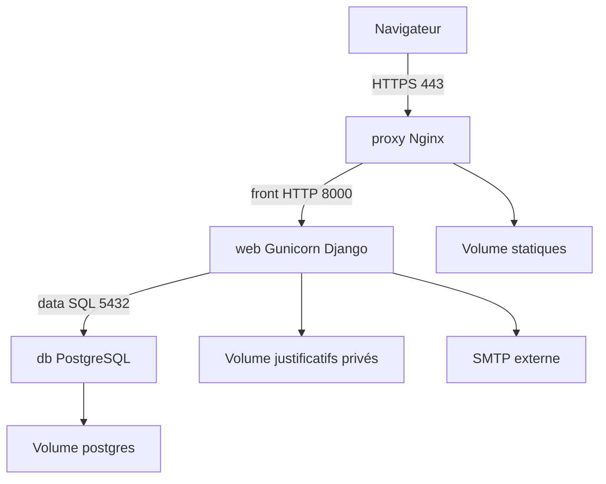

# Amblueo Services — Reprise des travaux par une IA

Version documentaire 1.0 — 22 novembre 2026 — pilote applicatif 0.1.0.

## Prompt de démarrage à utiliser dans une nouvelle session

Tu reprends Amblueo Services, un pilote web de gestion de projets, budgets et trésorerie pour les TPE et PME de services. Lis ce fichier en entier puis les instructions AGENTS.md applicables. Charge l’archive source jointe amblueo-services-pilote.zip dans un dossier de travail propre et examine les fichiers avant toute modification. Préserve les changements déjà présents si tu reprends un dépôt plus récent.

La mission immédiate est de reproduire et documenter le fonctionnement du pilote sous Docker Compose sur Debian 12 avec PostgreSQL 17, puis de corriger les problèmes reproductibles qui empêchent la recette. Commence par l’inventaire des versions et des commandes disponibles. Avance sur les étapes réversibles autorisées dans l’environnement de recette. Pour une règle métier ambiguë, prépare un cas chiffré et explicite la décision attendue tout en poursuivant les tâches indépendantes.

Après chaque modification, vérifie les droits, les calculs concernés, la cohérence des données, la compatibilité des migrations et la documentation. Rapporte les fichiers modifiés, les commandes exécutées, les résultats réellement observés et les points encore à valider. Mets à jour ce fichier avec les nouvelles preuves afin que la prochaine IA puisse reprendre.

## Sources et état des preuves

- Archive source de référence — amblueo-services-pilote.zip.
- Empreinte SHA256 de l’archive — c3b91bb0b0a22aa1ec274283e8be6013a7e7dfcc3f1b84961132b5c001582ce9.
- Document associé — AMBLUEO_SERVICES_DOSSIER_REFERENCE.docx.
- L’archive a été relue pour cette livraison. Les fichiers applicatifs locaux comparés correspondent à l’archive.
- Résultats historiques consignés dans docs/recette.md — quatre tests Django réussis sur PostgreSQL 16.2, restauration locale de la base et d’un justificatif, agrégats métier vérifiés.
- Les tests historiques n’ont pas été réexécutés pendant cette livraison documentaire.
- Le démarrage de bout en bout sous Compose avec PostgreSQL 17, HTTPS, SMTP et transfert de sauvegarde distant reste à valider sur l’hôte cible.
- Aucun serveur de production, domaine réel, identifiant ou secret n’est fourni dans ce document.

## Architecture réellement livrée

Monolithe Django avec templates serveur et CSS local. Une application pilot porte les trois domaines. Les entreprises partagent les tables et le schéma PostgreSQL. L’isolation repose sur l’adhésion active et le filtrage des objets par entreprise dans les vues et formulaires.



- Image web — python:3.12-slim-bookworm, utilisateur UID/GID 10001, deux workers Gunicorn.
- Versions enregistrées — Django 5.2.19, Gunicorn 26.2.0, psycopg et psycopg-binary 3.3.9. Voir requirements.txt pour les dépendances exactes.
- Images de services — nginx:1.28-alpine et postgres:17-bookworm.
- Compose requis — version 2.24.4 ou ultérieure, surcharge !override dans compose.prod.yaml.
- Réseaux — front pour proxy/web, data interne pour web/db.
- Local — port proxy 127.0.0.1:8080. Production — proxy 80/443, web et db sans port publié.
- Healthcheck — /health/ effectue SELECT 1.
- SQLite est proposé uniquement pour une vérification locale rapide. Le test concurrent requiert PostgreSQL.
- Les versions indiquées décrivent la livraison. Confirmer leur disponibilité et la construction avant de changer les dépendances.

## Fonctionnalités et contraintes présentes

1. Entreprises — création par compte connecté, XOF ou EUR, adhésions et quatre rôles.
2. Accès — connexion, récupération du mot de passe, liens d’invitation affichés à usage unique avec expiration à 48 heures, désactivation des membres hors dirigeants.
3. Projets — responsable, dates, statut planifié/en cours/terminé.
4. Tâches — responsable affecté, dates, charges estimée/réelle, statut à faire/en cours/terminée, retards. Un membre affecté peut modifier statut et charge réelle de sa tâche.
5. Budget — un par projet, édition en brouillon, approbation et verrouillage, disponible et alertes.
6. Opérations — dépenses/recettes, catégorie en texte, échéance unique, justificatif, validation.
7. Écritures — réalisations de dépenses et règlements partiels, UUID de répétition et verrouillage PostgreSQL, correction motivée avec conservation.
8. Trésorerie — ouverture unique par entreprise, solde consolidé, projection à 30 jours et impayés.
9. Exports — CSV UTF-8 avec BOM et séparateur point-virgule, filtre de projet et filtre sur les échéances des opérations. Les lignes de budget représentent le budget courant complet du projet, même avec filtre de période.
10. Audit — acteur, date, action, cible et motif pour les événements prévus dans les vues. Le tableau de bord affiche vingt événements récents. Le modèle actuel ne conserve pas systématiquement les anciennes et nouvelles valeurs de chaque champ.

Les fichiers joints sont limités par le formulaire à 8 Mio et aux extensions PDF/PNG/JPG/JPEG. Le code vérifie extension et taille. Le contrôle approfondi du contenu des fichiers reste à évaluer dans une évolution ciblée.

Les extensions discutées comprennent facturation, banque, Gantt, budgets versionnés et assistant IA. Elles sont au stade de backlog. Aucun service Redis/Celery, API REST séparée ou moteur IA n’est présent dans cette livraison.

## Règles financières à préserver

- Montants Decimal, DecimalField(max_digits=16, decimal_places=2), XOF entier validé par money().
- Dépense approuvée = engagement total du montant de l’opération.
- Engagement ouvert = montant approuvé − coûts réalisés actifs.
- Disponible = budget approuvé − réalisé − engagement ouvert.
- Risque après soumissions = disponible − dépenses soumises.
- Reste exigible d’une dépense = réalisé − réglé.
- Reste à recevoir d’une recette = montant de l’opération − encaissé.
- Solde courant = solde initial + paiements de recettes − paiements de dépenses, datés entre la référence et aujourd’hui.
- Prévision à trente jours = solde courant + recettes approuvées restantes − dépenses approuvées restantes, avec une échéance au plus tard à l’horizon. Les échéances passées sont incluses. La dépense prévisionnelle inclut la part approuvée encore à réaliser.
- La règle actuelle permet un dépassement de budget et affiche l’écart. Confirmer le besoin avant de rendre l’approbation bloquante.
- Transitions d’opération — draft vers submitted, submitted vers approved ou rejected, approved vers cancelled. Annulation avec motif après correction des écritures actives.
- Un règlement de dépense est limité au réalisé restant exigible. Un encaissement est limité au montant de recette restant.
- Une réalisation déjà couverte par un paiement doit être corrigée après le règlement correspondant.
- Une date d’écriture future est refusée.
- L’UUID de formulaire et le contenu de l’écriture empêchent la répétition du même règlement. Ne retire pas les transactions ni les verrous select_for_update.

### Scénario indépendant de recette

Budget de 1 000 000 XOF, dépense approuvée de 300 000 XOF, réalisation de 120 000 XOF, règlement de 50 000 XOF et ouverture de trésorerie de 500 000 XOF au jour du paiement.

| Indicateur | Attendu |
|---|---:|
| Réalisé | 120 000 XOF |
| Engagement ouvert | 180 000 XOF |
| Disponible | 700 000 XOF |
| Reste exigible | 70 000 XOF |
| Trésorerie courante | 450 000 XOF |
| Prévision à 30 jours si échéance incluse | 200 000 XOF |

Rejouer le même UUID doit conserver une seule écriture. Deux encaissements concurrents de 75 EUR sur une recette de 100 EUR doivent accepter une seule écriture et laisser 25 EUR. Tester aussi les accès croisés aux projets, aux justificatifs et aux exports entre deux entreprises.

## Convention de code demandée par le propriétaire

Variables, constantes et paramètres internes ajoutés — AMBLUEO_<MODULE>_<NOM_DE_LA_VARIABLE>, en majuscules. Exemples AMBLUEO_FINANCE_MONTANT_REGLEMENT, AMBLUEO_BUDGET_MONTANT_DISPONIBLE et AMBLUEO_INFRA_HOTE_BASE. Conserver les contrats imposés par Django, Python et Docker et les interfaces existantes. Les noms de classes, fonctions, champs Django, clés de contexte et identifiants externes suivent les contrats existants. Documenter les correspondances SECRET_KEY et POSTGRES_*.

Rédiger en français la documentation des règles, des commandes et des décisions. Chaque modification fonctionnelle inclut sa validation, ses droits, son effet sur les données et les erreurs attendues. Préserver les travaux de l’utilisateur et utiliser une modification ciblée.

## Plan de reprise et critères de validation

### Priorité 1 — Reproduire l’environnement

Lire README.md, requirements.txt, Dockerfile, compose.yaml, compose.prod.yaml et .env.example. Relever les versions effectives, vérifier la configuration, construire les images et démarrer en recette. Exécuter les tests sous PostgreSQL 17 et le contrôle des migrations. Consigner les résultats exacts, y compris les tests ignorés.

### Priorité 2 — Valider l’exploitation

Vérifier HTTPS et son renouvellement, récupération du mot de passe par SMTP, sauvegarde distante et restauration via les scripts livrés. Vérifier les soldes et la lisibilité d’un justificatif après restauration. Mesurer la durée de sauvegarde, l’interruption et la restauration. Renseigner domaine, hôte et responsables d’exploitation lorsqu’ils sont fournis.

### Priorité 3 — Faire confirmer les règles produit

Préparer des exemples sur la prévision de dépenses encore engagées, le dépassement de budget, le solde d’ouverture immuable et les informations de l’audit. Vérifier avec le propriétaire la règle souhaitée avant de changer les résultats financiers. Documenter les cas limites des dates antérieures à l’ouverture et des corrections après règlement.

### Priorité 4 — Organiser le pilote commercial

Mettre les utilisateurs en situation, relever les difficultés et définir une évolution à la fois. Les hypothèses commerciales discutées sont 59 € HT/mois et 250 € HT de mise en service en France, 15 000 FCFA/mois et 60 000 FCFA de mise en service au Mali. Ce sont des hypothèses à tester. Aucun moteur d’abonnement ou encaissement SaaS n’est livré.

## Commandes de recette

Depuis la racine extraite du dépôt, sur une cible de démonstration isolée.

```bash
cp .env.example .env
chmod 600 .env
./ops/compose.sh config --quiet
./ops/compose.sh up -d --wait db
./ops/compose.sh build web
./ops/compose.sh run --rm web python manage.py migrate
./ops/compose.sh run --rm web python manage.py collectstatic --noinput
./ops/compose.sh run --rm web python manage.py seed_demo
./ops/compose.sh up -d --wait
./ops/compose.sh run --rm web python manage.py test
./ops/compose.sh run --rm web python manage.py makemigrations --check --dry-run
./ops/compose.sh ps
curl -fsS http://127.0.0.1:8080/health/
```

Pour le diagnostic, utiliser ./ops/compose.sh logs --tail=100 web db proxy et contrôler l’espace disque. Le passage en production utilise AMBLUEO_INFRA_CIBLE=production et la procédure détaillée reproduite plus bas. Vérifier les secrets et les comptes de démonstration avant tout accueil de données réelles.

## Carte du dépôt et point d’entrée par type de changement

| Fichier | Usage |
|---|---|
| config/settings.py | Configuration Django, base, SMTP, sécurité et chemins |
| config/urls.py | Routes de l’interface et authentification |
| pilot/models.py | User, Company, Membership, Invitation, Project, Task, Budget, Operation, Posting, CashOpening, Audit |
| pilot/finance.py | Calculs, arrondis et écritures atomiques |
| pilot/views.py | Accès, workflows, export et téléchargement privé |
| pilot/forms.py | Validation des champs et justificatifs |
| pilot/templates/ | Interface HTML en français |
| pilot/static/pilot/app.css | Styles locaux |
| pilot/tests.py | Trois scénarios fonctionnels et un scénario concurrent |
| pilot/management/commands/seed_demo.py | Jeu de démonstration à deux entreprises |
| pilot/migrations/0001_initial.py | Schéma initial |
| ops/compose.sh | Sélection des configurations Compose |
| ops/backup.sh et restore.sh | Sauvegarde distante et restauration de recette |
| ops/nginx*.conf* | Proxy local et production |

## Compte rendu à remplir à la fin de la prochaine session

- Date, IA et environnement utilisés.
- Référence de l’archive ou commit repris.
- Demande du propriétaire et hypothèses retenues.
- Fichiers modifiés et décisions métier.
- Migrations créées et effet sur les données.
- Commandes exécutées et résultats observés.
- Résultats de recette, restauration et justificatifs consultés.
- Obstacles techniques précis et travaux encore à réaliser.
- Prochaine action concrète et critères de réussite.

## Documentation source intégrée pour une reprise autonome

Les sections suivantes reproduisent les documents du pilote de référence. Les chemins relatifs s’interprètent depuis la racine du dépôt extrait. Pour une version du code plus récente, relire les documents du dépôt et mettre à jour ce contexte.


---

## Source README.md

# Amblueo Services

Pilote de gestion des projets, des budgets et de la trésorerie pour les TPE et PME.
L'application Django utilise PostgreSQL et se déploie avec Docker Compose sur
Debian 12.

## Lancer la démonstration avec Docker

Il faut Docker Engine, le plugin Compose (2.24.4 ou ultérieur) et les ports locaux disponibles.

```bash
cp .env.example .env
chmod 600 .env
./ops/compose.sh up -d --wait db
./ops/compose.sh build web
./ops/compose.sh run --rm web python manage.py migrate
./ops/compose.sh run --rm web python manage.py collectstatic --noinput
./ops/compose.sh run --rm web python manage.py seed_demo
./ops/compose.sh up -d --wait
```

Ouvrir http://localhost:8080. Les comptes locaux `demo_dirigeant`,
`demo_projet`, `demo_finance`, `demo_collab` et `demo_second` utilisent
le mot de passe fictif `Amblueo-demo-local-42!`. Le dernier compte appartient
à une entreprise différente pour la recette d'isolation.

## Lancer les tests

```bash
./ops/compose.sh run --rm web python manage.py test
./ops/compose.sh run --rm web python manage.py makemigrations --check --dry-run
```

Pour une vérification rapide sans Docker, utiliser Python 3.12 et SQLite.
Le test de règlements concurrents est réservé à PostgreSQL.

```bash
python3.12 -m venv .venv
.venv/bin/pip install -r requirements.txt
AMBLUEO_INFRA_SQLITE=1 .venv/bin/python manage.py test
AMBLUEO_INFRA_SQLITE=1 .venv/bin/python manage.py migrate
AMBLUEO_INFRA_SQLITE=1 .venv/bin/python manage.py seed_demo
AMBLUEO_INFRA_SQLITE=1 .venv/bin/python manage.py runserver
```

## Documentation

- [Architecture et droits](docs/architecture.md)
- [Règles métier](docs/regles-metier.md)
- [Déploiement et exploitation](docs/exploitation.md)
- [Guide utilisateur](docs/guide-utilisateur.md)
- [Recette et vérifications](docs/recette.md)
- [Historique des versions](CHANGELOG.md)


---

## Source docs/architecture.md

# Architecture

Nginx expose l'interface et les assets publics. Gunicorn exécute Django sur
le réseau frontal de Compose. Seul le service Django rejoint le réseau de
données avec PostgreSQL. L'application est un monolithe dont les écrans,
les modèles et les règles financières sont séparés dans `pilot/`.

| Donnée | Rattachement | Rôle |
|---|---|---|
| Compte et adhésion | L'adhésion associe un compte à une entreprise | Rôle et état d'accès |
| Invitation | Entreprise, courriel, rôle, empreinte et expiration | Un lien à usage unique ouvre l'adhésion |
| Projet et tâche | Projet lié à l'entreprise, tâche liée au projet | Organisation du travail |
| Budget | Un montant par projet | Seul un budget approuvé alimente le disponible |
| Opération | Projet et auteur | Dépense ou recette dont la validation est suivie |
| Écriture | Opération et auteur | Réalisation ou règlement, avec clé de répétition |
| Ouverture de trésorerie | Une par entreprise | Solde de référence consolidé |
| Audit | Entreprise et auteur | Décisions, corrections et motifs |

L'appartenance active est contrôlée au début de chaque vue d'entreprise.
Les recherches d'objets et les choix de formulaires appliquent le même
périmètre. Les justificatifs résident dans un volume privé et passent par
une vue authentifiée. Le chemin du fichier est opaque.

| Action | Dirigeant | Chef de projet | Financier | Collaborateur |
|---|---|---|---|---|
| Inviter ou désactiver un membre | Oui | | | |
| Voir les projets et tâches de l'entreprise | Oui | Oui | Oui | Oui |
| Planifier les projets et affecter leurs tâches | Oui | Oui | | |
| Mettre à jour statut et charge réelle de sa tâche | Oui | Oui | Oui | Oui |
| Préparer un budget et une dépense | Oui | Oui | Oui | |
| Approuver budget et opérations | Oui | | Oui | |
| Saisir recettes, réalisations, règlements et corrections | Oui | | Oui | |
| Consulter budget, opérations, pièces et exports | Oui | Oui | Oui | |
| Gérer le solde d'ouverture, voir la trésorerie et l'audit | Oui | | Oui | |

Tout compte connecté peut ouvrir sa propre entreprise. Le pilote permet
au dirigeant d'approuver ses propres opérations. Le dirigeant ne peut
désactiver un autre dirigeant depuis l'interface. Les utilisateurs qui
doivent appartenir à plusieurs entreprises acceptent l'invitation avec
leur compte existant.

PostgreSQL est la référence pour la concurrence. Les mutations d'écritures
verrouillent leur opération. Les clés UUID de formulaire empêchent de rejouer
deux fois la même écriture. Un utilisateur doit présenter une adhésion active
au début de la requête. Une désactivation s'applique aux requêtes suivantes.


---

## Source docs/regles-metier.md

# Règles métier

Les montants sont stockés en décimal avec deux positions. À la saisie, XOF
exige un montant entier et EUR accepte deux décimales. Le logiciel refuse les
montants qui dépassent la précision admise. Les soldes sont des sommes et
différences exactes. La devise est fixée lors de la création de l'entreprise.
Les charges d'une tâche sont des heures décimales.

## Budget

Un budget en brouillon est modifiable. Le montant approuvé est verrouillé dans
le pilote. Une dépense passe par brouillon, soumission puis approbation ou rejet.
L'approbation nécessite un budget approuvé et peut constater un dépassement.
Les demandes soumises alimentent l'alerte de risque avant approbation.

- Engagement ouvert = montant approuvé de la dépense moins son réalisé.
- Disponible = budget approuvé moins coûts réalisés et engagements ouverts.
- Disponible prévisionnel = disponible moins dépenses soumises.
- Le paiement ne modifie pas le budget.

Avec 1 000 000 XOF en budget et 300 000 XOF approuvés, le disponible est
700 000 XOF. En réalisant 120 000 XOF, l'engagement ouvert passe à 180 000 XOF.
Le disponible reste 700 000 XOF.

## Trésorerie et corrections

Le solde d'ouverture est le solde avant les règlements du jour de référence.
Le solde courant additionne les encaissements et soustrait les décaissements
enregistrés depuis cette date, date de référence comprise. Chaque écriture
porte sa date effective. Les dates futures sont réservées aux échéances.

La prévision à 30 jours ajoute les recettes approuvées en attente et déduit les
dépenses approuvées encore sans règlement à cet horizon. Elle inclut la partie
encore engagée d'une dépense à partir de son échéance. Les impayés échus
figurent à part et sont inclus dans la projection. Leur montant exigible
correspond au réalisé non payé pour une dépense et au montant approuvé non
encaissé pour une recette.

Les règlements d'une dépense sont plafonnés par le coût réalisé restant.
Une annulation d'écriture exige un motif et conserve la ligne d'origine.
Une réalisation ne peut être annulée que si le montant réalisé corrigé
couvre les règlements actifs. Une opération approuvée peut ensuite être
annulée une fois toutes ses écritures actives annulées. Pour corriger le montant
d'une opération approuvée, annuler et ressaisir avec le bon montant.

Les lignes de budget du CSV sont cumulées au moment de l'export. Le filtre
de date s'applique à l'échéance des lignes d'opération.


---

## Source docs/exploitation.md

# Exploitation sur Debian 12

Prérequis : Docker Engine avec Compose ≥ 2.24.4, DNS vers le VPS, accès administrateur
SSH, Certbot, rsync, espace de sauvegarde distant et serveur SMTP. Ouvrir
80/443 et restreindre l'accès SSH. Les ports Django et PostgreSQL restent privés.

## Configuration

Créer `.env` depuis `.env.example`, avec permissions `0600`. La procédure
de production utilise `AMBLUEO_INFRA_CIBLE=production` pour charger la
surcharge Compose. Conserver une copie protégée de la configuration hors
du serveur, séparée des sauvegardes applicatives.

| Variable | Rôle et format | Usage | Exemple fictif |
|---|---|---|---|
| AMBLUEO_INFRA_MODE | Mode Django `local` ou `production` | Production imposée par la surcharge | `local` |
| AMBLUEO_INFRA_CIBLE | Surcharge du script Compose | Facultatif, local par défaut | `production` |
| AMBLUEO_INFRA_HOTES | Hôtes validés par Django, séparés par virgule | Obligatoire en production | `pilot.example.test` |
| AMBLUEO_INFRA_DOMAINE | Hôte public pour Nginx et TLS | Obligatoire en production | `pilot.example.test` |
| AMBLUEO_INFRA_IMAGE | Nom et tag de l'image web | Défaut local, versionner chaque livraison | `amblueo-services:0.1.0` |
| AMBLUEO_INFRA_NOM_BASE_DONNEES | Nom de base | Obligatoire sous Compose | `amblueo` |
| AMBLUEO_INFRA_UTILISATEUR_BASE | Compte PostgreSQL | Obligatoire sous Compose | `amblueo` |
| AMBLUEO_SECURITE_MOT_DE_PASSE_BASE | Secret PostgreSQL | Obligatoire sous Compose | `fictif-a-remplacer` |
| AMBLUEO_SECURITE_CLE_SECRETE | Clé Django longue et aléatoire | Obligatoire en production | `fictif-a-remplacer` |
| AMBLUEO_INFRA_HOTE_BASE | Hôte de la base | Fixé à `db` sous Compose | `db` |
| AMBLUEO_INFRA_PORT_BASE | Port PostgreSQL | Facultatif, par défaut 5432 | `5432` |
| AMBLUEO_INFRA_FUSEAU | Fuseau IANA | Facultatif, par défaut UTC | `Africa/Bamako` |
| AMBLUEO_INFRA_SQLITE | Active SQLite avec `1` en mode local | Facultatif hors Compose | `1` |
| AMBLUEO_INFRA_STATIQUES | Chemin absolu des assets compilés | Fixé sous Compose | `/data/static` |
| AMBLUEO_INFRA_JUSTIFICATIFS | Chemin du stockage privé | Fixé sous Compose | `/data/private` |
| AMBLUEO_INFRA_HOTE_SMTP | Nom DNS du serveur d'envoi | Production, pour la récupération | `smtp.example.test` |
| AMBLUEO_INFRA_PORT_SMTP | Port SMTP avec STARTTLS | Facultatif, par défaut 587 | `587` |
| AMBLUEO_INFRA_UTILISATEUR_SMTP | Identifiant SMTP | Selon fournisseur | `robot@example.test` |
| AMBLUEO_SECURITE_MOT_DE_PASSE_SMTP | Secret SMTP | Selon fournisseur | `fictif-a-remplacer` |
| AMBLUEO_INFRA_EXPEDITEUR | Adresse d'expédition | Obligatoire en production | `robot@example.test` |
| AMBLUEO_INFRA_DESTINATION_SAUVEGARDE | Destination rsync sur SSH | Obligatoire pour le script | `backup@backup.example.test:/srv/amblueo` |

Compose traduit les trois paramètres de base en `POSTGRES_DB`,
`POSTGRES_USER` et `POSTGRES_PASSWORD` pour l'image officielle. Django lit
`AMBLUEO_SECURITE_CLE_SECRETE` et renseigne son paramètre `SECRET_KEY`.
`COMPOSE_PROJECT_NAME` est un paramètre natif de Compose, obligatoire pour
le script de restauration. Les noms du framework et des outils gardent
leurs conventions publiques.

## Premier déploiement

Reporter le vrai domaine dans `.env` et les commandes ci-dessous. Le nom
du certificat doit correspondre exactement au domaine Nginx.

```bash
sudo install -d -m 755 /var/www/amblueo-acme
sudo certbot certonly --standalone --cert-name pilot.example.test -d pilot.example.test
export AMBLUEO_INFRA_CIBLE=production
./ops/compose.sh config --quiet
./ops/compose.sh build web
./ops/compose.sh up -d --wait db
./ops/compose.sh run --rm web python manage.py migrate
./ops/compose.sh run --rm web python manage.py collectstatic --noinput
./ops/compose.sh run --rm web python manage.py createsuperuser
./ops/compose.sh up -d --wait
curl -fsS https://pilot.example.test/health/
```

Se connecter avec le premier compte et créer l'entreprise. Configurer ensuite
la méthode de renouvellement Certbot en `webroot`, répertoire
`/var/www/amblueo-acme`, puis vérifier avec `certbot renew --dry-run`.
Le conteneur proxy doit être rechargé après un renouvellement réussi.
Installer un hook d'exécution root qui lance
`AMBLUEO_INFRA_CIBLE=production /chemin/ops/compose.sh exec -T proxy nginx -s reload`.
Vérifier le SMTP avec une demande de réinitialisation réelle de recette.

## Sauvegardes et restauration

Les volumes `postgres`, `justificatifs` et `statiques` conservent respectivement
les données, les fichiers privés et les assets. Les assets se régénèrent par
`collectstatic`. Ne supprimez les volumes qu'après avoir identifié la cible
et vérifié la sauvegarde.

Planifier `ops/backup.sh` quotidiennement hors des heures d'usage avec la
destination SSH et le profil de production. La courte interruption de Django
synchronise le dump et les fichiers. Le script redémarre l'application avant
le transfert et publie l'heure de succès dans `backups/derniere-sauvegarde-epoch`.
Préconfigurer la clé SSH, l'empreinte de l'hôte, les droits du dossier distant
et la rétention. Pour le pilote, conserver 14 sauvegardes quotidiennes et
3 mensuelles. Restreindre l'accès au serveur de sauvegarde et chiffrer le
stockage distant.

Pour tester une restauration, utiliser un hôte ou un projet Compose séparé
avec des volumes vides, la même version de PostgreSQL et une archive de
confiance ramenée par SSH. Éviter le conflit de port 8080 en arrêtant le proxy
local existant ou en utilisant un autre hôte. L'environnement de recette
doit rester privé et utiliser un SMTP neutralisé.

```bash
export COMPOSE_PROJECT_NAME=amblueo-recette-001
export AMBLUEO_INFRA_CIBLE=local
./ops/restore.sh /chemin/amblueo-archive.tar.gz
./ops/compose.sh run --rm web python manage.py collectstatic --noinput
./ops/compose.sh up -d --wait
```

Ouvrir une entreprise restaurée, comparer le budget, le solde et un justificatif
avec les valeurs d'origine. Mesurer le temps de restauration. Une sauvegarde
quotidienne expose à la perte des écritures depuis la dernière sauvegarde réussie.

## Maintenance et diagnostic

- Vérifier `/health/`, la place disque et l'âge du dernier transfert dans Zabbix.
  Déclencher une alerte après 26 heures sans transfert réussi.
- Utiliser `./ops/compose.sh ps` et
  `./ops/compose.sh logs --tail=100 web db proxy` pour diagnostiquer un incident.
- Avant une mise à jour, tester l'image et les migrations sur une restauration
  de recette. Sauvegarder, préparer le nouveau tag, arrêter proxy et web,
  exécuter les migrations et collecter les statiques, puis redémarrer avec
  `up -d --wait`. Vérifier HTTPS et le parcours financier.
- Pour revenir en arrière, reprendre le tag précédent et republier les assets
  correspondants. Si une migration est incompatible, résoudre la migration
  avant de relancer l'ancien code. Une restauration complète peut perdre les
  écritures postérieures à la sauvegarde.
- Planifier la migration de l'hôte Debian 12 et la revue régulière des images,
  dépendances Python, certificats et comptes techniques.


---

## Source docs/recette.md

# Recette du pilote

Utiliser le jeu fictif du README et repartir d'une base dédiée aux tests.

| Scénario | Actions | Attendu |
|---|---|---|
| Invitation | Créer un lien de collaborateur, l'accepter, le rouvrir et désactiver le membre | Une seule activation, accès retiré après désactivation |
| Projet | Créer un projet avec une tâche de 8 h affectée au collaborateur | Le collaborateur met sa charge réelle à 7 h et termine la tâche |
| Isolation | Depuis Studio Latitude, tenter d'ouvrir les URL d'un projet, d'un document et d'un export d'Atelier Horizon | Réponse 404 et aucune modification |
| Permissions | Préparer le budget avec le chef de projet, tenter de l'approuver, puis changer pour le financier | Le chef reçoit 403 et le financier approuve |
| Engagement | Approuver 300 000 XOF sur 1 000 000 XOF, puis réaliser 120 000 XOF | Réalisé 120 000, ouvert 180 000, disponible 700 000 |
| Paiement | Ouvrir la trésorerie à 500 000 XOF, puis régler 50 000 XOF le jour de référence | Exigible 70 000, courant 450 000, disponible 700 000 |
| Export | Exporter le projet après ce paiement | Les colonnes Réalisé, Engagé ouvert, Disponible et Restant exigible correspondent au tableau |
| Correction | Annuler le règlement avec le motif « Saisie en doublon constatée » | Écriture conservée, motif dans l'historique, trésorerie courante à 500 000 |
| Concurrence | Lancer deux paiements de 75 sur une recette de 100 sous PostgreSQL | Un seul paiement est accepté, solde de 25 |
| Restauration | Restaurer le dump et les pièces sur une cible séparée | Recalcul cohérent, justificatif lisible et migrations présentes |

La recette du déploiement inclut la construction des images, les contrôles
d'état Compose, HTTPS, SMTP, une sauvegarde hors hôte et la restauration via
les scripts d'exploitation sur l'environnement cible.

## Vérifications effectuées

Les quatre tests Django ont réussi avec PostgreSQL 16.2, y compris deux
règlements simultanés. Le dump PostgreSQL et un justificatif ont été
restaurés vers une autre base et un autre dossier. Les agrégats 120 000,
180 000 et 700 000 XOF et le contenu du fichier ont été recontrôlés.

Le test de restauration local utilise les utilitaires PostgreSQL et tar.
Il reste à exécuter les scripts de bout en bout avec Docker Compose,
PostgreSQL 17, et le service de sauvegarde de l'hôte Debian 12. Vérifier
aussi les ports, les certificats et l'envoi SMTP sur cet hôte.


---

## Source docs/guide-utilisateur.md

# Guide utilisateur

1. **Dirigeant** — Connectez-vous et ouvrez ou créez une entreprise. Dans
   Équipe, choisissez « Inviter un membre », sélectionnez un rôle, puis
   transmettez le lien à la personne concernée. Le lien expire en 48 heures.
   Une personne déjà inscrite se connecte avant d'accepter. « Désactiver »
   coupe l'accès à cette entreprise.
2. **Chef de projet** — Créez un projet et sélectionnez son responsable.
   Ajoutez les tâches et leurs échéances. Préparez le budget et soumettez
   les dépenses en joignant les justificatifs nécessaires.
3. **Collaborateur** — Ouvrez une tâche qui vous est affectée pour mettre à
   jour son statut et sa charge réelle.
4. **Financier** — Approuvez le budget, puis approuvez ou rejetez les demandes.
   Ouvrez une dépense approuvée pour enregistrer un coût réalisé, puis son
   règlement. Pour une recette, saisissez le montant attendu, soumettez-la,
   approuvez-la et enregistrez l'encaissement.
5. **Trésorerie et export** — Initialisez une fois le solde d'ouverture.
   Consultez la projection et les impayés sur le tableau de bord. Pour
   rapprocher les chiffres, sélectionnez un projet et une période dans le CSV.
6. **Correction** — Depuis la fiche opération, sélectionnez « Corriger » sur
   l'écriture, indiquez le motif et enregistrez l'écriture exacte au besoin.
   L'historique récent est visible sur la page de l'entreprise.

La page de connexion propose une réinitialisation du mot de passe. En local,
le lien figure dans les journaux de Django. En production, il est envoyé par SMTP.


## Empreintes des fichiers de référence

```text
6737ab4277c4ef1925729048d96812878a7f215a35c6999b5ed07ee12758bf37  requirements.txt
baca744a11e4e1809606d4e65da4eb1a3c71e58cc077296ec6d5e7bf990f215c  Dockerfile
f0ef860a3ac88e69c85cd27f558e16297a7125c9be13585524fad65a3c2e212e  compose.yaml
283e81f0b91307fc75d3ce1dd454a601bc9a48ccb247f399d5dbb5e205fc7cf4  compose.prod.yaml
28dc5c7f0940ebd9abbd8677158bc65896e2b949c787fbbcfa0fa658418ed53c  config/settings.py
68fddb0d254ce6b6f35dd652e120061f5f683a34b55d08ffab392f7df64e7a18  config/urls.py
71f8fb297bf00a8d4af65457edbdbe2f6599b7a7a9edbd5334faea3671e22851  pilot/models.py
bff77d94e7cc1c49f52ce544d59a2c9812bff99f78cc72d7a892432a33ba0ab5  pilot/finance.py
bed6ad984614841fe80841633064d86e5105a9d4890af7369e51348e811321c9  pilot/views.py
19ad49c4ef22d67086fa206429547b5dcd6c9bab661c425e05fcba87733a22c1  pilot/forms.py
06c645d3620a5307b22bf261901ab021ec34c1adfda879410dac98a6c20c9315  pilot/tests.py
b88677bff1e89625336b0bf9f2aaf0029468cc633eda1597afaa5125d9813ccc  ops/backup.sh
cf5e45ac52c0e76549fcfd4794ca4f349bc3b372a4202acdd0e2b4e08538c5b0  ops/restore.sh
```
